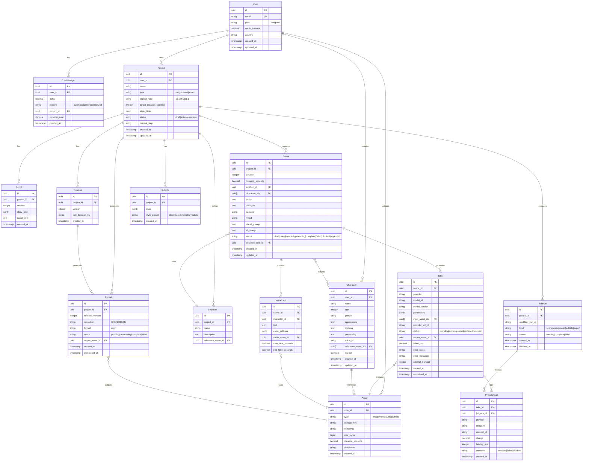

# Design Document: AKUKO AI Video Studio

## Overview

AKUKO AI Video Studio is a web application that orchestrates AI video generation to produce long-form videos (30+ minutes) from story ideas. The system implements a four-layer architecture with provider independence at its core, enabling seamless model swapping without code rewrites.

### Design Philosophy

The architecture follows three core principles derived from the requirements:

1. **Provider Independence**: All AI models are replaceable parts behind a provider abstraction layer
2. **State Preservation**: Every script, character, and completed scene survives failures, closed tabs, and provider outages
3. **Assembly Over Monolith**: Long-form videos are built from many short scene jobs (8-30 seconds each), never one giant model request

### Target Users

| Persona | Primary Need | Key Feature |
|---------|--------------|-------------|
| Storyteller | Consistent characters, voiced dialogue | Character reference kits, voice synthesis |
| YouTube Creator | Speed, subtitles, 16:9 export | Quick create, auto-subtitles |
| Small Business | Templates, vertical 9:16 format | Template library, aspect ratio options |
| Educator | Documentary style, clear narration | Voice options, structured narratives |

---

## Architecture

### High-Level Architecture

The system implements a four-layer architecture with clear boundaries between presentation, application logic, provider abstraction, and infrastructure:

```
┌─────────────────────────────────────────────────────────────────────────────┐
│                              WEB LAYER                                       │
│  ┌─────────────────────────────────────────────────────────────────────┐   │
│  │  Next.js App Router + React + TypeScript                             │   │
│  │  Landing │ Dashboard │ Studio (Characters, Story, Scenes, Editor)    │   │
│  │  Server Actions │ API Routes │ Real-time Subscriptions               │   │
│  └─────────────────────────────────────────────────────────────────────┘   │
└─────────────────────────────────────────────────────────────────────────────┘
                                      │
                                      ▼
┌─────────────────────────────────────────────────────────────────────────────┐
│                           APPLICATION LAYER                                  │
│  ┌──────────────────┐  ┌──────────────────┐  ┌──────────────────┐          │
│  │   PostgreSQL     │  │  Supabase Auth   │  │  Trigger.dev     │          │
│  │   (Supabase)     │  │  Email + Google  │  │  Workflow Engine │          │
│  │   Row-Level Sec  │  │  Email Verify    │  │  Durable Tasks   │          │
│  └──────────────────┘  └──────────────────┘  └──────────────────┘          │
│                                                                              │
│  ┌──────────────────────────────────────────────────────────────────────┐   │
│  │  Supabase Realtime (Scene/Take status updates < 3s)                  │   │
│  └──────────────────────────────────────────────────────────────────────┘   │
└─────────────────────────────────────────────────────────────────────────────┘
                                      │
                                      ▼
┌─────────────────────────────────────────────────────────────────────────────┐
│                           PROVIDER LAYER (CRITICAL)                          │
│  ┌──────────────────────────────────────────────────────────────────────┐   │
│  │  Provider Interfaces (Only code that knows vendor names)             │   │
│  │  ┌────────────┐ ┌────────────┐ ┌────────────┐ ┌────────────┐        │   │
│  │  │VideoProvider│ │ImageProvider│ │VoiceProvider│ │MusicProvider│       │   │
│  │  └────────────┘ └────────────┘ └────────────┘ └────────────┘        │   │
│  │  ┌────────────┐                                                       │   │
│  │  │LLMProvider │                                                       │   │
│  │  └────────────┘                                                       │   │
│  └──────────────────────────────────────────────────────────────────────┘   │
│                                                                              │
│  ┌──────────────────────────────────────────────────────────────────────┐   │
│  │  Model Registry: Capabilities, Pricing, Limits                        │   │
│  │  Aggregators: fal / Higgsfield (Kling, Seedance, Wan, Veo)           │   │
│  └──────────────────────────────────────────────────────────────────────┘   │
└─────────────────────────────────────────────────────────────────────────────┘
                                      │
                                      ▼
┌─────────────────────────────────────────────────────────────────────────────┐
│                          INFRASTRUCTURE LAYER                                │
│  ┌──────────────────┐  ┌──────────────────┐  ┌──────────────────┐          │
│  │  Cloudflare R2   │  │  FFmpeg Worker   │  │  Hosting         │          │
│  │  File Storage    │  │  Container       │  │  Vercel +        │          │
│  │  No egress fees  │  │  Render Engine   │  │  Trigger.dev     │          │
│  │  Signed URLs     │  │  Concat, Mix     │  │  CloudRun/Fly.io │          │
│  └──────────────────┘  └──────────────────┘  └──────────────────┘          │
│                                                                              │
│  ┌──────────────────────────────────────────────────────────────────────┐   │
│  │  Observability: Sentry (errors) │ PostHog (analytics) │ OTEL (traces)│   │
│  └──────────────────────────────────────────────────────────────────────┘   │
└─────────────────────────────────────────────────────────────────────────────┘
```

### Sync vs Async Boundaries

**Synchronous Operations (< 10 seconds)**:
- Saving edits, loading projects
- Expanding single prompts
- Creating signed URLs
- Authentication operations

**Asynchronous Operations (via Trigger.dev)**:
- Story and script generation
- Character reference sheet generation
- Every scene video generation
- Voice lines synthesis
- Music generation
- Subtitle generation
- Final video rendering/assembly

**Direct File Transfer Pattern**:
The browser never sends large files through the webapp. All uploads and downloads use short-lived signed URLs directly to Cloudflare R2, reducing server load and improving performance.

### Data Flow Overview

```
User Action → Next.js Server Action → Domain Layer → Trigger.dev Task
                                                          │
                                                          ▼
                                              Provider Layer (AI Call)
                                                          │
                                                          ▼
                                              R2 Storage (Copy Output)
                                                          │
                                                          ▼
                                              Database Update (Status)
                                                          │
                                                          ▼
                                              Real-time Push to Browser
```

---

## Components and Interfaces

### Provider Abstraction Layer

The provider layer is the critical architectural component that enables model independence. UI and workflow code never import vendor SDKs directly; adapters do.

#### VideoProvider Interface

```typescript
interface VideoProvider {
  readonly name: string;
  
  submitJob(request: VideoJobRequest): Promise<ProviderJobResult>;
  checkStatus(jobId: string): Promise<ProviderJobStatus>;
  cancelJob?(jobId: string): Promise<void>;
}

interface VideoJobRequest {
  idempotencyKey: string;
  prompt: string;
  referenceAssetIds: string[];
  aspectRatio: '16:9' | '9:16' | '1:1';
  durationSeconds: number;
  startFrameAssetId?: string;
  modelId: string;
  modelVersion: string;
  parameters: Record<string, unknown>;
}

interface ProviderJobResult {
  status: 'pending' | 'running' | 'complete' | 'failed' | 'blocked';
  outputURL?: string;
  billedCost: number;
  providerJobId: string;
  errorClass?: 'validation' | 'content_policy' | 'provider_error' | 'timeout';
  errorMessage?: string;
}
```

#### ImageProvider Interface

```typescript
interface ImageProvider {
  readonly name: string;
  
  generateImage(request: ImageJobRequest): Promise<ProviderJobResult>;
  generateVariations?(assetId: string, count: number): Promise<ProviderJobResult[]>;
}

interface ImageJobRequest {
  idempotencyKey: string;
  prompt: string;
  aspectRatio: '16:9' | '9:16' | '1:1' | '3:4' | '1:1';
  styleBible?: string;
  modelId: string;
  parameters: Record<string, unknown>;
}
```

#### VoiceProvider Interface

```typescript
interface VoiceProvider {
  readonly name: string;
  
  synthesize(request: VoiceJobRequest): Promise<ProviderJobResult>;
  cloneVoice?(audioSamples: string[]): Promise<string>; // Returns voice_id
  getVoices(): Promise<VoiceProfile[]>;
}

interface VoiceJobRequest {
  idempotencyKey: string;
  text: string;
  voiceId: string;
  settings: VoiceSettings;
  modelId: string;
}

interface VoiceSettings {
  speed: number;        // 0.5 - 2.0
  stability: number;    // 0 - 1
  similarity: number;   // 0 - 1
  style?: number;       // 0 - 1
  accent?: string;
  emotion?: string;
}

interface VoiceProfile {
  id: string;
  name: string;
  language: string;
  accent?: string;
  gender?: string;
  previewUrl?: string;
}
```

#### MusicProvider Interface

```typescript
interface MusicProvider {
  readonly name: string;
  
  generateMusic(request: MusicJobRequest): Promise<ProviderJobResult>;
  searchLibrary(query: MusicSearchQuery): Promise<MusicTrack[]>;
}

interface MusicJobRequest {
  idempotencyKey: string;
  prompt: string;
  durationSeconds: number;
  mood?: string;
  modelId: string;
}

interface MusicSearchQuery {
  mood?: string;
  genre?: string;
  duration?: number;
  keywords?: string[];
}
```

#### LLMProvider Interface

```typescript
interface LLMProvider {
  readonly name: string;
  
  generateStructured<T>(request: LLMJobRequest, schema: ZodSchema<T>): Promise<T>;
  generateText(request: LLMJobRequest): Promise<string>;
}

interface LLMJobRequest {
  idempotencyKey: string;
  systemPrompt: string;
  userPrompt: string;
  modelId: string;
  temperature?: number;
  maxTokens?: number;
}
```

### Model Registry

The Model Registry stores capabilities and limits for each AI model, enabling automatic scene planning adjustments:

```typescript
interface ModelRegistry {
  getVideoModels(): VideoModelInfo[];
  getImageModels(): ImageModelInfo[];
  getVoiceModels(): VoiceModelInfo[];
  getMusicModels(): MusicModelInfo[];
  getLLMModels(): LLMModelInfo[];
  
  getVideoModel(id: string): VideoModelInfo | undefined;
  getDefaultModel(type: ProviderType, tier: 'draft' | 'standard' | 'premium'): ModelInfo;
}

interface VideoModelInfo {
  id: string;
  provider: string;
  displayName: string;
  version: string;
  
  // Capabilities
  maxClipSeconds: number;
  supportedAspectRatios: ('16:9' | '9:16' | '1:1')[];
  maxReferenceImages: number;
  maxReferenceVideos: number;
  audioSupport: boolean;
  
  // Pricing
  pricePerSecond: number;
  currency: string;
  
  // Quality tier
  tier: 'draft' | 'standard' | 'premium';
  
  // Availability
  available: boolean;
  deprecatedDate?: Date;
  fallbackModelId?: string;
  
  // Concurrency
  maxConcurrentJobs: number;
}
```

### Workflow Engine Integration

Trigger.dev manages all asynchronous AI generation jobs with durability and resumability:

#### Scene Generation Task

```typescript
// Trigger.dev task definition
export const generateSceneTask = task({
  id: 'generate-scene',
  run: async (payload: SceneJobPayload, { ctx }: RunContext) => {
    const { sceneId, projectId, userId } = payload;
    
    // 1. Validate inputs and reserve credits
    await validateSceneInputs(sceneId);
    await reserveCredits(userId, sceneId);
    
    // 2. Prepare request with references
    const scene = await getSceneWithRelations(sceneId);
    const references = await buildReferenceKit(scene);
    
    // 3. Submit to provider with idempotency
    const idempotencyKey = `${sceneId}-${Date.now()}`;
    const result = await videoProvider.submitJob({
      idempotencyKey,
      prompt: scene.aiPrompt,
      referenceAssetIds: references,
      durationSeconds: scene.duration,
      // ... other params
    });
    
    // 4. Handle result based on status
    if (result.status === 'complete') {
      // Copy to R2 immediately (providers delete files)
      const r2Key = await copyToR2(result.outputURL, userId);
      await updateTakeStatus(sceneId, 'complete', r2Key, result.billedCost);
      await chargeCredits(userId, result.billedCost);
    } else if (result.status === 'failed') {
      await handleFailedJob(sceneId, result);
    }
    
    return { sceneId, status: result.status };
  },
});
```

#### Retry and Error Handling

```typescript
// Retry configuration
const RETRY_CONFIG = {
  maxAttempts: 3,
  backoff: {
    type: 'exponential',
    initialDelay: 2000,
    maxDelay: 30000,
  },
  retryOn: ['network_error', '5xx', 'timeout'],
  noRetryOn: ['4xx', 'validation', 'content_policy'],
};

async function handleJobError(error: ProviderError, attempt: number, maxAttempts: number) {
  // 4xx validation errors - don't retry
  if (error.class === 'validation' || error.class === 'content_policy') {
    return { action: 'fail', reason: error.message };
  }
  
  // Network/5xx errors - retry with exponential backoff
  if (attempt < maxAttempts && shouldRetry(error)) {
    const delay = calculateBackoff(attempt);
    await sleep(delay);
    return { action: 'retry' };
  }
  
  // Final attempt failed - try fallback model if available
  const fallbackModel = await getFallbackModel(error.modelId);
  if (fallbackModel && userAllowsFallback()) {
    return { action: 'fallback', modelId: fallbackModel.id };
  }
  
  return { action: 'fail', reason: 'All retry attempts exhausted' };
}
```

### Long-Form Generation Pipeline

The pipeline orchestrates the complete video generation workflow:

```
┌─────────────────────────────────────────────────────────────────────────────┐
│                    LONG-FORM GENERATION PIPELINE                             │
└─────────────────────────────────────────────────────────────────────────────┘

1. PLAN ──────────────────────────────────────────────────────────────────────
   Input: Approved Script
   Output: Scene List (validated JSON)
   
   ┌─────────────────┐     ┌─────────────────┐     ┌─────────────────┐
   │ Script Parser   │ ──▶ │ LLM Scene Plan  │ ──▶ │ Zod Validation  │
   │                 │     │                 │     │                 │
   │ Extract:        │     │ Generate:       │     │ Validate:       │
   │ - Characters    │     │ - Duration      │     │ - Schema match  │
   │ - Locations     │     │ - Location      │     │ - Duration fits │
   │ - Dialogue      │     │ - Action        │     │ - Refs valid    │
   │ - Actions       │     │ - Dialogue      │     │                 │
   └─────────────────┘     │ - Camera        │     └─────────────────┘
                           │ - Mood          │              │
                           └─────────────────┘              ▼
                                               ┌─────────────────┐
                                               │ Auto Repair     │
                                               │ (if validation  │
                                               │  fails)         │
                                               └─────────────────┘

2. LOCK REFERENCES ───────────────────────────────────────────────────────────
   Input: Character definitions
   Output: Locked reference kits (2-6 images each)
   
   ┌─────────────────┐     ┌─────────────────┐     ┌─────────────────┐
   │ Generate        │ ──▶ │ User Approval   │ ──▶ │ Lock & Store    │
   │ Reference Kit   │     │                 │     │                 │
   │                 │     │ Review each     │     │ Set locked flag │
   │ Headshot        │     │ image           │     │ Store asset IDs │
   │ Full body       │     │ Regenerate      │     │ Prevent modify  │
   │ Turnaround      │     │ individuals     │     │                 │
   └─────────────────┘     └─────────────────┘     └─────────────────┘
   
   ⚠️ SCENE JOBS DO NOT START UNTIL REFERENCES ARE LOCKED

3. VOICE FIRST ───────────────────────────────────────────────────────────────
   Input: Scene dialogue
   Output: Voice audio files + measured durations
   
   ┌─────────────────┐     ┌─────────────────┐     ┌─────────────────┐
   │ Extract         │ ──▶ │ Voice Synthesis │ ──▶ │ Measure & Store │
   │ Dialogue Lines  │     │ (per character) │     │                 │
   │                 │     │                 │     │ Get audio       │
   │ Group by        │     │ Apply voice     │     │ duration        │
   │ character       │     │ settings        │     │ Set scene       │
   │                 │     │                 │     │ duration from   │
   └─────────────────┘     └─────────────────┘     │ speech length   │
                                                   └─────────────────┘

4. KEYFRAMES ─────────────────────────────────────────────────────────────────
   Input: Scenes with locked references
   Output: Start frame images for each scene
   
   ┌─────────────────┐     ┌─────────────────┐
   │ Generate Start  │ ──▶ │ User Approval   │
   │ Frame from      │     │                 │
   │ References      │     │ Cheap stills    │
   │                 │     │ approved before │
   │ For adjacent    │     │ video paid for  │
   │ scenes: use     │     │                 │
   │ last frame      │     └─────────────────┘
   └─────────────────┘

5. RUN SCENE JOBS ────────────────────────────────────────────────────────────
   Input: Approved scenes with keyframes
   Output: Video clips
   
   ┌─────────────────────────────────────────────────────────────────────────┐
   │                    SCENE JOB QUEUE                                      │
   │                                                                         │
   │  ┌──────┐ ┌──────┐ ┌──────┐ ┌──────┐ ┌──────┐ ┌──────┐ ┌──────┐       │
   │  │Scene │ │Scene │ │Scene │ │Scene │ │Scene │ │Scene │ │Scene │       │
   │  │  01  │ │  02  │ │  03  │ │  04  │ │  05  │ │  06  │ │  07  │ ...   │
   │  │ ✓    │ │ ⏳   │ │ ⏳   │ │ ⏳   │ │ ⏸️   │ │ ⏸️   │ │ ⏸️   │       │
   │  └──────┘ └──────┘ └──────┘ └──────┘ └──────┘ └──────┘ └──────┘       │
   │                                                                         │
   │  ✓ Complete  ⏳ Generating  ⏸️ Waiting (concurrency limit)             │
   │                                                                         │
   │  Concurrency: Limited by provider (e.g., 20 concurrent jobs)           │
   │  Failed scene: Stops only itself, queue continues                      │
   │  Idempotency: Key on every submission prevents duplicates              │
   └─────────────────────────────────────────────────────────────────────────┘
   
   For each job:
   ┌─────────────────┐
   │ Validate Input  │
   │ Reserve Credits │
   │ Submit to       │
   │ Provider        │
   │ (idempotency)   │
   │ Wait for        │
   │ Webhook/Poll    │
   │ Copy to R2      │
   │ Charge Credits  │
   │ Update Status   │
   └─────────────────┘

6. REVIEW ────────────────────────────────────────────────────────────────────
   Input: Completed scenes
   Output: Approved/rejected scene list
   
   ┌─────────────────┐     ┌─────────────────┐     ┌─────────────────┐
   │ Preview Scene   │ ──▶ │ User Decision   │ ──▶ │ Action          │
   │                 │     │                 │     │                 │
   │ Auto-display    │     │ Approve ✓       │     │ Mark approved   │
   │ on completion   │     │ Regenerate ↻    │     │ Queue new job   │
   │                 │     │ Edit Prompt ✎  │     │ Update prompt   │
   └─────────────────┘     └─────────────────┘     └─────────────────┘

7. MIX ───────────────────────────────────────────────────────────────────────
   Input: Approved scenes
   Output: Timeline with audio tracks
   
   ┌─────────────────┐     ┌─────────────────┐     ┌─────────────────┐
   │ Add Music       │ ──▶ │ Add SFX         │ ──▶ │ Set Levels      │
   │                 │     │                 │     │                 │
   │ Mood-based      │     │ Searchable      │     │ Voice level     │
   │ selection       │     │ library         │     │ Music level     │
   │ Custom upload   │     │ Custom upload   │     │ Ducking         │
   └─────────────────┘     └─────────────────┘     └─────────────────┘

8. ASSEMBLE AND EXPORT ───────────────────────────────────────────────────────
   Input: Timeline JSON
   Output: Final MP4
   
   ┌─────────────────────────────────────────────────────────────────────────┐
   │                    FFmpeg RENDER PIPELINE                               │
   │                                                                         │
   │  Input: Timeline JSON (Edit Decision List)                              │
   │                                                                         │
   │  Steps:                                                                 │
   │  1. Concatenate scenes in chunks                                        │
   │  2. Mix audio tracks (voice, music, SFX)                                │
   │  3. Burn in subtitles                                                   │
   │  4. Encode to MP4 (H.264/AAC)                                           │
   │  5. Store as immutable file in R2                                       │
   │                                                                         │
   │  Resolutions: 720p, 1080p, 4K (if supported)                            │
   │  Format: MP4 (H.264 video, AAC audio)                                   │
   └─────────────────────────────────────────────────────────────────────────┘
```

### Scene State Machine

```
                                    ┌───────────────────────────────────────┐
                                    │                                       │
                                    ▼                                       │
┌─────────┐   Accept Prompt   ┌─────────┐   Queue Job   ┌─────────┐          │
│  DRAFT  │ ───────────────▶ │  READY  │ ─────────────▶ │ QUEUED  │          │
└─────────┘                   └─────────┘               └─────────┘          │
     ▲                             │                        │                 │
     │                             │                        │                 │
     │                             │ ◀──────────────────────┤                 │
     │                             │       Cancel           │                 │
     │                             │                        │                 │
     │                             │                        ▼                 │
     │                             │                  ┌───────────┐           │
     │                             │                  │           │           │
     │                             │                  │ GENERATING│           │
     │                             │                  │           │           │
     │                             │                  └───────────┘           │
     │                             │                        │                 │
     │                             │           ┌────────────┼────────────┐    │
     │                             │           │            │            │    │
     │                             │           ▼            ▼            ▼    │
     │                             │     ┌─────────┐ ┌─────────┐ ┌─────────┐ │
     │                             │     │COMPLETE │ │ FAILED  │ │ BLOCKED │ │
     │                             │     └─────────┘ └─────────┘ └─────────┘ │
     │                             │           │            │            │    │
     │                       Edit Prompt      │            │            │    │
     │                             │           │       Try Again    Edit Prompt
     │                             │           │            │            │    │
     │                             │           ▼            │            │    │
     │                             │     ┌─────────┐        │            │    │
     │                             │     │APPROVED │ ◀──────┘            │    │
     │                             │     └─────────┘                     │    │
     │                             │           │                         │    │
     │                             │   Regenerate                       │    │
     │                             │           │                         │    │
     └─────────────────────────────┴───────────┘                         │    │
                                                                             │
                  User sees:                                                 │
                  ────────────────────────────────────────────────────────────
                  draft:     "Edit and Accept Prompt"                       
                  ready:     "Generate Scene"                               
                  queued:    "Waiting" (status chip amber)                   
                  generating: "Creating Scene 08 of 90" (never just "Loading")
                  complete:  "Preview, Accept, Regenerate"                   
                  failed:    Plain-language reason, Try Again, Edit Prompt   
                  blocked:   Explanation and Edit Prompt                     
                  approved:  Green tick                                      
```

---

## Data Models

### Entity Relationship Diagram



### Database Schema

```sql
-- Users and Authentication
CREATE TABLE users (
    id UUID PRIMARY KEY DEFAULT gen_random_uuid(),
    email VARCHAR(255) UNIQUE NOT NULL,
    plan VARCHAR(50) DEFAULT 'free',
    credit_balance DECIMAL(10, 2) DEFAULT 0.00,
    country VARCHAR(100),
    created_at TIMESTAMPTZ DEFAULT NOW(),
    updated_at TIMESTAMPTZ DEFAULT NOW()
);

-- Append-only credit ledger
CREATE TABLE credit_ledger (
    id UUID PRIMARY KEY DEFAULT gen_random_uuid(),
    user_id UUID NOT NULL REFERENCES users(id) ON DELETE CASCADE,
    delta DECIMAL(10, 2) NOT NULL,
    reason VARCHAR(50) NOT NULL,
    project_id UUID REFERENCES projects(id) ON DELETE SET NULL,
    provider_cost DECIMAL(10, 4),
    created_at TIMESTAMPTZ DEFAULT NOW()
);

-- Projects
CREATE TABLE projects (
    id UUID PRIMARY KEY DEFAULT gen_random_uuid(),
    user_id UUID NOT NULL REFERENCES users(id) ON DELETE CASCADE,
    name VARCHAR(255) NOT NULL,
    type VARCHAR(50),
    aspect_ratio VARCHAR(10) DEFAULT '16:9',
    target_duration_seconds INTEGER DEFAULT 1800, -- 30 minutes
    style_bible JSONB,
    status VARCHAR(50) DEFAULT 'draft',
    current_step VARCHAR(50) DEFAULT 'setup',
    created_at TIMESTAMPTZ DEFAULT NOW(),
    updated_at TIMESTAMPTZ DEFAULT NOW()
);

-- Characters (reusable across projects)
CREATE TABLE characters (
    id UUID PRIMARY KEY DEFAULT gen_random_uuid(),
    user_id UUID NOT NULL REFERENCES users(id) ON DELETE CASCADE,
    name VARCHAR(255) NOT NULL,
    age INTEGER,
    gender VARCHAR(50),
    appearance TEXT,
    clothing TEXT,
    personality TEXT,
    voice_id VARCHAR(255),
    reference_asset_ids UUID[] DEFAULT '{}',
    locked BOOLEAN DEFAULT FALSE,
    created_at TIMESTAMPTZ DEFAULT NOW(),
    updated_at TIMESTAMPTZ DEFAULT NOW()
);

-- Locations
CREATE TABLE locations (
    id UUID PRIMARY KEY DEFAULT gen_random_uuid(),
    project_id UUID NOT NULL REFERENCES projects(id) ON DELETE CASCADE,
    name VARCHAR(255) NOT NULL,
    description TEXT,
    reference_asset_id UUID REFERENCES assets(id) ON DELETE SET NULL
);

-- Scripts with version history
CREATE TABLE scripts (
    id UUID PRIMARY KEY DEFAULT gen_random_uuid(),
    project_id UUID NOT NULL REFERENCES projects(id) ON DELETE CASCADE,
    version INTEGER DEFAULT 1,
    story_json JSONB,
    script_text TEXT,
    created_at TIMESTAMPTZ DEFAULT NOW()
);

-- Scenes with sortable position
CREATE TABLE scenes (
    id UUID PRIMARY KEY DEFAULT gen_random_uuid(),
    project_id UUID NOT NULL REFERENCES projects(id) ON DELETE CASCADE,
    position DECIMAL(10, 4) NOT NULL, -- Sortable key for drag-and-drop
    duration_seconds DECIMAL(6, 2) DEFAULT 10.0,
    location_id UUID REFERENCES locations(id) ON DELETE SET NULL,
    character_ids UUID[] DEFAULT '{}',
    action TEXT,
    dialogue TEXT,
    camera VARCHAR(100),
    mood VARCHAR(100),
    visual_prompt TEXT,
    ai_prompt TEXT,
    status VARCHAR(50) DEFAULT 'draft',
    selected_take_id UUID REFERENCES takes(id) ON DELETE SET NULL,
    created_at TIMESTAMPTZ DEFAULT NOW(),
    updated_at TIMESTAMPTZ DEFAULT NOW()
);

CREATE INDEX idx_scenes_project_position ON scenes(project_id, position);

-- Takes (generation attempts)
CREATE TABLE takes (
    id UUID PRIMARY KEY DEFAULT gen_random_uuid(),
    scene_id UUID NOT NULL REFERENCES scenes(id) ON DELETE CASCADE,
    provider VARCHAR(100) NOT NULL,
    model_id VARCHAR(100) NOT NULL,
    model_version VARCHAR(50),
    parameters JSONB,
    input_asset_ids UUID[] DEFAULT '{}',
    provider_job_id VARCHAR(255),
    status VARCHAR(50) DEFAULT 'pending',
    output_asset_id UUID REFERENCES assets(id) ON DELETE SET NULL,
    billed_cost DECIMAL(10, 4),
    error_class VARCHAR(50),
    error_message TEXT,
    attempt_number INTEGER DEFAULT 1,
    created_at TIMESTAMPTZ DEFAULT NOW(),
    completed_at TIMESTAMPTZ
);

CREATE INDEX idx_takes_scene ON takes(scene_id);
CREATE INDEX idx_takes_provider_job ON takes(provider_job_id);

-- Assets (files in R2 storage)
CREATE TABLE assets (
    id UUID PRIMARY KEY DEFAULT gen_random_uuid(),
    user_id UUID NOT NULL REFERENCES users(id) ON DELETE CASCADE,
    type VARCHAR(50) NOT NULL, -- image, video, audio, subtitle
    storage_key VARCHAR(500) NOT NULL,
    mimetype VARCHAR(100),
    size_bytes BIGINT,
    duration_seconds DECIMAL(6, 2),
    checksum VARCHAR(64),
    created_at TIMESTAMPTZ DEFAULT NOW()
);

CREATE INDEX idx_assets_user_type ON assets(user_id, type);

-- Voice lines
CREATE TABLE voice_lines (
    id UUID PRIMARY KEY DEFAULT gen_random_uuid(),
    scene_id UUID NOT NULL REFERENCES scenes(id) ON DELETE CASCADE,
    character_id UUID REFERENCES characters(id) ON DELETE SET NULL,
    text TEXT NOT NULL,
    voice_settings JSONB,
    audio_asset_id UUID REFERENCES assets(id) ON DELETE SET NULL,
    start_time_seconds DECIMAL(6, 3),
    end_time_seconds DECIMAL(6, 3)
);

-- Timeline (edit decision list)
CREATE TABLE timelines (
    id UUID PRIMARY KEY DEFAULT gen_random_uuid(),
    project_id UUID NOT NULL REFERENCES projects(id) ON DELETE CASCADE,
    version INTEGER DEFAULT 1,
    edit_decision_list JSONB NOT NULL,
    created_at TIMESTAMPTZ DEFAULT NOW()
);

-- Subtitles
CREATE TABLE subtitles (
    id UUID PRIMARY KEY DEFAULT gen_random_uuid(),
    project_id UUID NOT NULL REFERENCES projects(id) ON DELETE CASCADE,
    cues JSONB NOT NULL, -- [{start, end, text, style}]
    style_preset VARCHAR(50) DEFAULT 'clean',
    created_at TIMESTAMPTZ DEFAULT NOW()
);

-- Exports (immutable)
CREATE TABLE exports (
    id UUID PRIMARY KEY DEFAULT gen_random_uuid(),
    project_id UUID NOT NULL REFERENCES projects(id) ON DELETE CASCADE,
    timeline_version INTEGER,
    resolution VARCHAR(10) NOT NULL,
    format VARCHAR(10) DEFAULT 'mp4',
    status VARCHAR(50) DEFAULT 'pending',
    output_asset_id UUID REFERENCES assets(id) ON DELETE SET NULL,
    created_at TIMESTAMPTZ DEFAULT NOW(),
    completed_at TIMESTAMPTZ
);

-- Job runs (workflow tracking)
CREATE TABLE job_runs (
    id UUID PRIMARY KEY DEFAULT gen_random_uuid(),
    project_id UUID NOT NULL REFERENCES projects(id) ON DELETE CASCADE,
    workflow_run_id VARCHAR(255) NOT NULL,
    kind VARCHAR(50) NOT NULL,
    status VARCHAR(50) DEFAULT 'running',
    started_at TIMESTAMPTZ DEFAULT NOW(),
    finished_at TIMESTAMPTZ
);

-- Provider calls (cost tracking)
CREATE TABLE provider_calls (
    id UUID PRIMARY KEY DEFAULT gen_random_uuid(),
    take_id UUID REFERENCES takes(id) ON DELETE SET NULL,
    job_run_id UUID REFERENCES job_runs(id) ON DELETE SET NULL,
    provider VARCHAR(100) NOT NULL,
    endpoint VARCHAR(255) NOT NULL,
    request_id VARCHAR(255),
    charge DECIMAL(10, 4),
    latency_ms INTEGER,
    outcome VARCHAR(50) NOT NULL,
    created_at TIMESTAMPTZ DEFAULT NOW()
);

-- Row-Level Security Policies
ALTER TABLE projects ENABLE ROW LEVEL SECURITY;
ALTER TABLE scenes ENABLE ROW LEVEL SECURITY;
ALTER TABLE takes ENABLE ROW LEVEL SECURITY;
ALTER TABLE assets ENABLE ROW LEVEL SECURITY;

CREATE POLICY "Users can access own projects" ON projects
    FOR ALL USING (user_id = auth.uid());

CREATE POLICY "Users can access scenes in own projects" ON scenes
    FOR ALL USING (
        project_id IN (SELECT id FROM projects WHERE user_id = auth.uid())
    );

CREATE POLICY "Users can access takes in own scenes" ON takes
    FOR ALL USING (
        scene_id IN (
            SELECT s.id FROM scenes s
            JOIN projects p ON s.project_id = p.id
            WHERE p.user_id = auth.uid()
        )
    );

CREATE POLICY "Users can access own assets" ON assets
    FOR ALL USING (user_id = auth.uid());
```

---

## API Design

### REST API Endpoints

```
Authentication (Supabase Auth)
─────────────────────────────────────────────────────────────────────
POST   /auth/signup                 Create account
POST   /auth/signin                 Sign in
POST   /auth/signout                Sign out
GET    /auth/user                   Get current user

Projects
─────────────────────────────────────────────────────────────────────
GET    /api/projects                List user's projects
POST   /api/projects                Create new project
GET    /api/projects/:id            Get project details
PATCH  /api/projects/:id            Update project
DELETE /api/projects/:id            Delete project

Characters
─────────────────────────────────────────────────────────────────────
GET    /api/characters              List user's characters
POST   /api/characters              Create character
GET    /api/characters/:id          Get character details
PATCH  /api/characters/:id          Update character
DELETE /api/characters/:id          Delete character
POST   /api/characters/:id/generate Generate reference kit
POST   /api/characters/:id/lock     Lock character references

Scripts
─────────────────────────────────────────────────────────────────────
GET    /api/projects/:id/scripts    Get script versions
POST   /api/projects/:id/scripts    Create new script version
POST   /api/projects/:id/generate-story    Generate story from idea
POST   /api/projects/:id/generate-script   Generate full script

Scenes
─────────────────────────────────────────────────────────────────────
GET    /api/projects/:id/scenes     List project scenes
POST   /api/projects/:id/scenes     Create scene
PATCH  /api/scenes/:id              Update scene
DELETE /api/scenes/:id              Delete scene
POST   /api/scenes/reorder          Reorder scenes
POST   /api/scenes/:id/generate     Generate single scene

Generation
─────────────────────────────────────────────────────────────────────
POST   /api/projects/:id/generate   Start generation queue
GET    /api/projects/:id/jobs       Get job status
POST   /api/jobs/:id/cancel         Cancel job
POST   /api/jobs/:id/retry          Retry failed job

Timeline
─────────────────────────────────────────────────────────────────────
GET    /api/projects/:id/timeline   Get current timeline
POST   /api/projects/:id/timeline   Save timeline version

Subtitles
─────────────────────────────────────────────────────────────────────
GET    /api/projects/:id/subtitles  Get subtitles
POST   /api/projects/:id/subtitles  Generate subtitles
PATCH  /api/subtitles/:id           Update subtitle cues

Exports
─────────────────────────────────────────────────────────────────────
POST   /api/projects/:id/export     Start export
GET    /api/exports/:id             Get export status
GET    /api/exports/:id/download    Get download URL

Assets
─────────────────────────────────────────────────────────────────────
POST   /api/assets/upload-url       Get signed upload URL
GET    /api/assets/:id/download-url Get signed download URL
DELETE /api/assets/:id              Delete asset

Webhooks
─────────────────────────────────────────────────────────────────────
POST   /webhooks/provider/:provider Provider callback
POST   /webhooks/payment            Payment callback
```

### Real-time Subscriptions

```typescript
// Supabase Realtime channels
const channels = {
  // Scene status updates
  sceneUpdates: supabase
    .channel(`project:${projectId}:scenes`)
    .on('postgres_changes', {
      event: 'UPDATE',
      schema: 'public',
      table: 'scenes',
      filter: `project_id=eq.${projectId}`,
    }, (payload) => {
      // Update TanStack Query cache
      queryClient.setQueryData(['scenes', projectId], (old) => {
        return old.map(scene => 
          scene.id === payload.new.id ? { ...scene, ...payload.new } : scene
        );
      });
    }),
    
  // Take status updates
  takeUpdates: supabase
    .channel(`project:${projectId}:takes`)
    .on('postgres_changes', {
      event: '*', // INSERT, UPDATE
      schema: 'public',
      table: 'takes',
    }, (payload) => {
      // Update take in cache
    }),
};
```

---

## Security and Safety

### Authentication Security

1. **Email Verification Required**: Users must verify email before accessing generation features
2. **Disposable Email Blocking**: Common disposable email domains are rejected at registration
3. **Multi-factor Options**: Google OAuth provides additional identity verification
4. **Session Management**: Secure session handling via Supabase Auth

### Row-Level Security (RLS)

All user-scoped tables have RLS enabled with policies ensuring users can only access their own data:

```sql
-- Projects: Users can only access their own projects
CREATE POLICY "Users can access own projects" ON projects
    FOR ALL USING (user_id = auth.uid());

-- Scenes: Users can only access scenes in their projects
CREATE POLICY "Users can access scenes in own projects" ON scenes
    FOR ALL USING (
        project_id IN (SELECT id FROM projects WHERE user_id = auth.uid())
    );
```

### Content Moderation

```typescript
interface ModerationResult {
  allowed: boolean;
  reason?: string;
  category?: 'illegal' | 'harmful' | 'impersonation' | 'sexual' | 'violence';
}

async function moderatePrompt(prompt: string): Promise<ModerationResult> {
  // 1. Check against prohibited content patterns
  // 2. Reject photorealistic depictions of real people
  // 3. Check for harmful content indicators
  // 4. Return result with reason if blocked
}

// Applied before any provider submission
// Blocked scenes are marked with explanation
// Users can edit prompt after rejection
```

### Abuse Prevention

| Control | Implementation |
|---------|----------------|
| Email verification | Required before generation |
| Disposable emails | Blocked at registration |
| Bot prevention | Cloudflare Turnstile on sign-up and first generation |
| Per-account limits | Daily generation cap |
| Per-IP limits | Rate limiting by IP address |
| Global spend cap | Admin kill switch for emergency shutdown |

### Signed URLs for File Access

All file access uses short-lived signed URLs (15 minutes) to prevent unauthorized access:

```typescript
async function getSignedUploadUrl(userId: string, fileType: string): Promise<string> {
  const key = `users/${userId}/${uuid()}.${extension}`;
  return await r2.createSignedUrl(key, 'PUT', expiresIn: 900);
}

async function getSignedDownloadUrl(assetId: string): Promise<string> {
  const asset = await getAsset(assetId);
  // Verify user has access to this asset
  await verifyAssetAccess(asset, userId);
  return await r2.createSignedUrl(asset.storage_key, 'GET', expiresIn: 900);
}
```

---

## Performance Optimization

### Frontend Performance

| Strategy | Implementation |
|----------|----------------|
| Virtualized lists | React-window for 90-225 scene lists |
| Low-res proxies | 360p preview proxies for editor scrubbing |
| Lazy-loaded thumbnails | Intersection Observer for thumbnail loading |
| Data-saver toggle | User preference to reduce data usage |
| Resumable uploads | Chunked uploads with resume capability |

### Real-time Performance

| Requirement | Target | Implementation |
|-------------|--------|----------------|
| Dashboard load | < 2s on 4G | Optimistic UI, minimal initial data |
| Status updates | < 3s to browser | Supabase Realtime subscriptions |
| Concurrent projects | 100 in Phase 1 | Database connection pooling, queue limits |

### Backend Performance

| Strategy | Implementation |
|----------|----------------|
| Direct file transfer | Signed URLs bypass server |
| Job queuing | Trigger.dev with concurrency limits |
| Checkpointing | Workflow state saved at each step |
| Provider caching | Model registry cached, refreshed hourly |

---

## Deployment and Infrastructure

### Hosting Architecture

```
┌─────────────────────────────────────────────────────────────────────────────┐
│                           PRODUCTION ENVIRONMENT                             │
└─────────────────────────────────────────────────────────────────────────────┘

┌─────────────────┐     ┌─────────────────┐     ┌─────────────────┐
│    VERCEL       │     │ TRIGGER.DEV     │     │ CLOUDRUN/FLY.IO │
│    Web App      │     │ Cloud           │     │ FFmpeg Worker   │
│                 │     │                 │     │                 │
│ - Next.js SSR   │     │ - Job Queue     │     │ - Scene concat  │
│ - API Routes    │     │ - Task Execution│     │ - Audio mix     │
│ - Static Assets │     │ - Webhooks      │     │ - Subtitle burn │
└─────────────────┘     └─────────────────┘     └─────────────────┘
         │                       │                       │
         │                       │                       │
         ▼                       ▼                       ▼
┌─────────────────────────────────────────────────────────────────────────────┐
│                         MANAGED SERVICES                                     │
│                                                                              │
│  ┌──────────────────┐  ┌──────────────────┐  ┌──────────────────┐          │
│  │ SUPABASE         │  │ CLOUDFLARE R2    │  │ AI PROVIDERS     │          │
│  │                  │  │                  │  │                  │          │
│  │ - PostgreSQL     │  │ - Video storage  │  │ - fal/Higgsfield │          │
│  │ - Auth           │  │ - Audio storage  │  │ - ElevenLabs     │          │
│  │ - Realtime       │  │ - Image storage  │  │ - Anthropic      │          │
│  └──────────────────┘  └──────────────────┘  └──────────────────┘          │
│                                                                              │
│  ┌──────────────────────────────────────────────────────────────────────┐   │
│  │ OBSERVABILITY                                                         │   │
│  │ Sentry (errors) │ PostHog (analytics) │ OpenTelemetry (traces)       │   │
│  └──────────────────────────────────────────────────────────────────────┘   │
└─────────────────────────────────────────────────────────────────────────────┘
```

### Environment Configuration

```yaml
# Required Environment Variables

# Authentication
NEXT_PUBLIC_SUPABASE_URL=https://xxx.supabase.co
NEXT_PUBLIC_SUPABASE_ANON_KEY=xxx
SUPABASE_SERVICE_ROLE_KEY=xxx

# Storage
R2_ACCOUNT_ID=xxx
R2_ACCESS_KEY_ID=xxx
R2_SECRET_ACCESS_KEY=xxx
R2_BUCKET_NAME=akuko-videos

# Workflow Engine
TRIGGER_SECRET_KEY=xxx

# AI Providers
FAL_API_KEY=xxx
ANTHROPIC_API_KEY=xxx
ELEVENLABS_API_KEY=xxx

# Payments
STRIPE_SECRET_KEY=xxx
STRIPE_WEBHOOK_SECRET=xxx
PAYSTACK_SECRET_KEY=xxx

# Observability
NEXT_PUBLIC_SENTRY_DSN=xxx
NEXT_PUBLIC_POSTHOG_KEY=xxx

# Safety
CLOUDFLARE_TURNSTILE_SECRET=xxx
```

### CI/CD Pipeline

```yaml
# GitHub Actions Workflow
name: CI/CD Pipeline

on:
  push:
    branches: [main]
  pull_request:
    branches: [main]

jobs:
  test:
    runs-on: ubuntu-latest
    steps:
      - uses: actions/checkout@v4
      - uses: actions/setup-node@v4
        with:
          node-version: '20'
          cache: 'pnpm'
      
      - name: Install dependencies
        run: pnpm install
      
      - name: Run linter
        run: pnpm lint
      
      - name: Run type check
        run: pnpm type-check
      
      - name: Run unit tests
        run: pnpm test:unit
      
      - name: Run integration tests
        run: pnpm test:integration
      
      - name: Run E2E tests
        run: pnpm test:e2e

  deploy:
    needs: test
    if: github.ref == 'refs/heads/main'
    runs-on: ubuntu-latest
    steps:
      - name: Deploy to Vercel
        run: vercel --prod
```

---

## Error Handling

### Error Classification

```typescript
enum ErrorClass {
  // Provider errors
  VALIDATION = 'validation',       // 4xx - don't retry
  CONTENT_POLICY = 'content_policy', // Safety filter rejection
  PROVIDER_ERROR = 'provider_error', // 5xx - retry
  TIMEOUT = 'timeout',             // Network timeout - retry
  
  // Application errors
  INSUFFICIENT_CREDITS = 'insufficient_credits',
  PROJECT_NOT_FOUND = 'project_not_found',
  UNAUTHORIZED = 'unauthorized',
  
  // System errors
  INTERNAL_ERROR = 'internal_error',
}

interface AppError {
  code: string;
  class: ErrorClass;
  message: string;
  userMessage: string; // Plain language for UI
  retryable: boolean;
  action?: 'edit_prompt' | 'try_again' | 'contact_support';
}
```

### Error Response Format

```typescript
// API error response
{
  "error": {
    "code": "SCENE_GENERATION_FAILED",
    "class": "provider_error",
    "message": "Video model returned 5xx after 3 retry attempts",
    "userMessage": "We couldn't create this scene right now. Please try again.",
    "retryable": true,
    "action": "try_again"
  }
}
```

### Failed Scene Handling

When a scene fails:
1. Only that scene stops; the queue continues
2. Scene is marked as `failed` with error class and message
3. User sees plain-language explanation
4. Actions offered: "Try Again" or "Edit Prompt"
5. All other scenes and takes are preserved
6. Credit reservation is refunded automatically

---

## Testing Strategy

### Unit Tests

Focus on:
- Provider layer adapters with mocked responses
- Credit calculation and ledger operations
- Scene state transitions
- Prompt validation and moderation
- Zod schema validation for JSON outputs

```typescript
// Example: Provider adapter test
describe('VideoProvider', () => {
  it('should submit job with idempotency key', async () => {
    const provider = new FalVideoProvider(mockConfig);
    const result = await provider.submitJob({
      idempotencyKey: 'test-key-123',
      prompt: 'A woman walking in a park',
      // ...
    });
    
    expect(result.status).toBe('pending');
    expect(result.providerJobId).toBeDefined();
  });
});
```

### Integration Tests

Focus on:
- End-to-end user journeys (idea to export)
- Workflow engine task execution
- Database operations with RLS policies
- Real-time subscription behavior
- Webhook handling and de-duplication

### E2E Tests (Playwright)

Critical user flows:
1. New user signup and first video creation
2. Project creation and character setup
3. Story generation and script editing
4. Scene generation and approval
5. Timeline editing and export

```typescript
// Example: E2E test for scene generation
test('user can generate and approve a scene', async ({ page }) => {
  await page.goto('/projects/test-project/generate');
  await page.click('[data-testid="generate-scene-1"]');
  await page.waitForSelector('[data-testid="scene-complete"]');
  await page.click('[data-testid="approve-scene"]');
  await expect(page.locator('[data-testid="scene-status"]')).toHaveText('approved');
});
```

### Property-Based Testing

PBT is appropriate for this feature as it involves:
- Pure functions with clear input/output (JSON validation, prompt transformation)
- Universal properties across input space (state transitions, credit calculations)
- Data transformations (story parsing, timeline operations)

See Correctness Properties section for detailed property definitions.

---

## Correctness Properties

*A property is a characteristic or behavior that should hold true across all valid executions of a system—essentially, a formal statement about what the system should do. Properties serve as the bridge between human-readable specifications and machine-verifiable correctness guarantees.*

### Property 1: Scene State Machine Integrity

*For any* scene, state transitions SHALL only occur according to the defined state machine: draft → ready → queued → generating → (complete | failed | blocked) → approved. Invalid transitions SHALL be rejected.

**Validates: Requirements 8.1, 10.8**

### Property 2: Idempotent Job Submission

*For any* scene job request with the same idempotency key submitted multiple times, exactly one job SHALL be created and charged.

**Validates: Requirements 8.10**

### Property 3: Webhook De-duplication

*For any* webhook delivery, multiple deliveries with the same provider request ID SHALL result in exactly one job status update in the database.

**Validates: Requirements 8.11, 10.5**

### Property 4: Credit Ledger Atomicity

*For any* credit operation, the ledger entry SHALL be created atomically such that the sum of all deltas for a user equals their current balance. Ledger entries SHALL be append-only (never modified or deleted).

**Validates: Requirements 18.6**

### Property 5: State Preservation Across Failures

*For any* project with completed work (scripts, characters, scenes), any failure (provider error, system crash, browser close) SHALL preserve all previously completed work unchanged.

**Validates: Requirements 16.1, 16.4, 8.4**

### Property 6: Scene Position Integrity After Reorder

*For any* drag-and-drop scene reorder operation, all scene positions SHALL remain unique and properly sortable without requiring updates to rows that were not moved.

**Validates: Requirements 6.9**

### Property 7: JSON Schema Validation

*For any* structured JSON output from the LLM (story, script, scene plan), it SHALL validate against the defined Zod schema. When automatic repair is invoked, the repaired output SHALL also validate against the schema.

**Validates: Requirements 5.2, 5.3**

### Property 8: Provider Response Standardization

*For any* provider response (video, image, voice, music, LLM), it SHALL contain the standardized result shape: status, outputURL, billedCost, providerJobId, and errorClass when applicable.

**Validates: Requirements 17.5**

### Property 9: R2 Copy Completeness

*For any* successfully completed provider job, the output file SHALL be copied to R2 storage and the asset record created before the scene status is updated to complete.

**Validates: Requirements 8.7**

### Property 10: Voice-Scene Duration Alignment

*For any* scene with generated voice lines, the scene duration SHALL be set to match the total speech length within 0.3 seconds tolerance. Video generation SHALL wait for voice completion.

**Validates: Requirements 12.3, 12.4**

### Property 11: Scene Duration Validation

*For any* scene duration input, it SHALL be validated against the selected video model's maximum clip length. Durations exceeding the model limit SHALL be rejected.

**Validates: Requirements 6.7**

### Property 12: Generation Job Isolation

*For any* failed scene job, only that scene SHALL stop; all other scenes in the queue SHALL continue processing without interruption.

**Validates: Requirements 10.8, 8.5**

### Property 13: Retry Policy Correctness

*For any* job error, retry behavior SHALL follow the policy: network errors and 5xx responses retry with exponential backoff up to 3 attempts; 4xx validation errors do not retry.

**Validates: Requirements 10.2, 10.3**

### Property 14: Reference Kit Approval Requirement

*For any* scene generation attempt, if the character's reference kit is not approved (locked), the generation SHALL be rejected with appropriate error message.

**Validates: Requirements 15.4, 4.10**

### Property 15: Credit Refund on Failure

*For any* take that fails or is blocked by moderation, reserved credits SHALL be automatically refunded to the user's balance.

**Validates: Requirements 18.5**

### Property 16: Character Reference Kit Size

*For any* generated character reference kit, the number of images SHALL be between 2 and 6 inclusive.

**Validates: Requirements 4.3, 15.1**

### Property 17: Moderation Gate

*For any* prompt submission, moderation validation SHALL occur before the request is sent to any AI provider. Prompts depicting real people photorealistically SHALL be rejected.

**Validates: Requirements 19.1, 19.2**

### Property 18: Real-time Status Update Latency

*For any* scene status change in the database, the browser SHALL receive the update via real-time subscription within 3 seconds.

**Validates: Requirements 22.2, 9.4**

### Property 19: Email Domain Validation

*For any* registration attempt with a known disposable email domain, the registration SHALL be rejected with an appropriate error message.

**Validates: Requirements 1.5**

### Property 20: Generation Access Control

*For any* unverified user, all generation endpoints SHALL return forbidden (403) until email verification is complete.

**Validates: Requirements 1.4**

---

## Appendix: Visual System Tokens

### Design Tokens

| Token | Value | Usage |
|-------|-------|-------|
| `--color-bg` | `#0B0B10` | App canvas background |
| `--color-panel` | `#15151C` | Cards, sidebars, timeline |
| `--color-border` | `#26262F` | 1px borders |
| `--color-text-primary` | `#FFFFFF` | Headings |
| `--color-text-secondary` | `#A1A1AA` | Body text |
| `--color-accent-start` | `#7C5CFF` | Gradient start (purple) |
| `--color-accent-end` | `#3B82F6` | Gradient end (blue) |
| `--color-status-complete` | `#22C55E` | Green |
| `--color-status-waiting` | `#F59E0B` | Amber |
| `--color-status-failed` | `#EF4444` | Red |
| `--color-status-generating` | `#3B82F6` | Blue |

### Typography Scale

| Element | Font | Size | Weight |
|---------|------|------|--------|
| H1 | Manrope | 32px | 700 |
| H2 | Manrope | 24px | 600 |
| H3 | Manrope | 18px | 600 |
| Body | Inter | 14-16px | 400 |
| Caption | Inter | 12px | 400 |
| Mono | JetBrains Mono | 14px | 400 |

### Spacing Grid

Base unit: 8px

| Token | Value |
|-------|-------|
| `--space-1` | 4px |
| `--space-2` | 8px |
| `--space-3` | 16px |
| `--space-4` | 24px |
| `--space-5` | 32px |
| `--space-6` | 48px |
